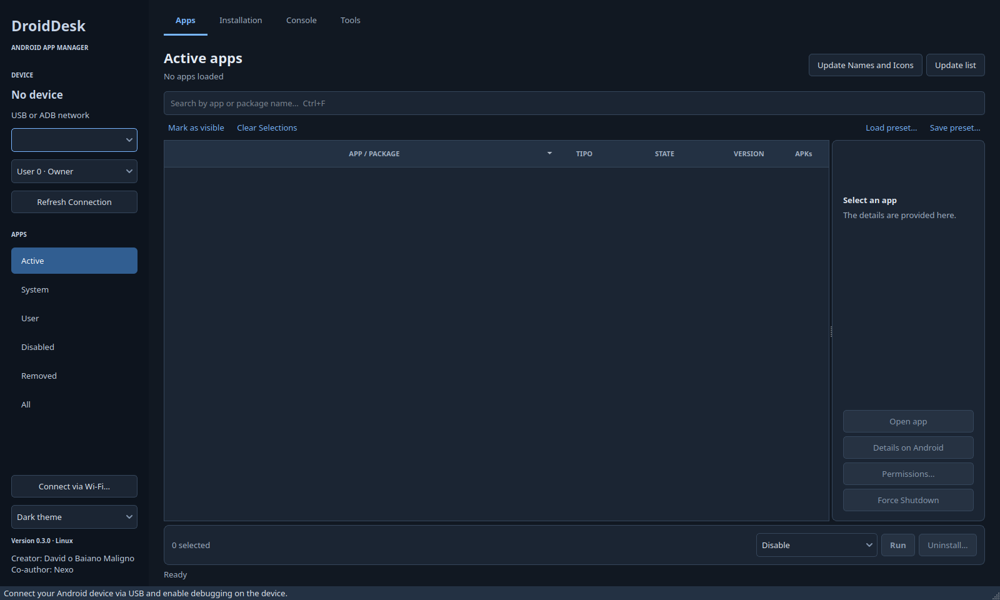
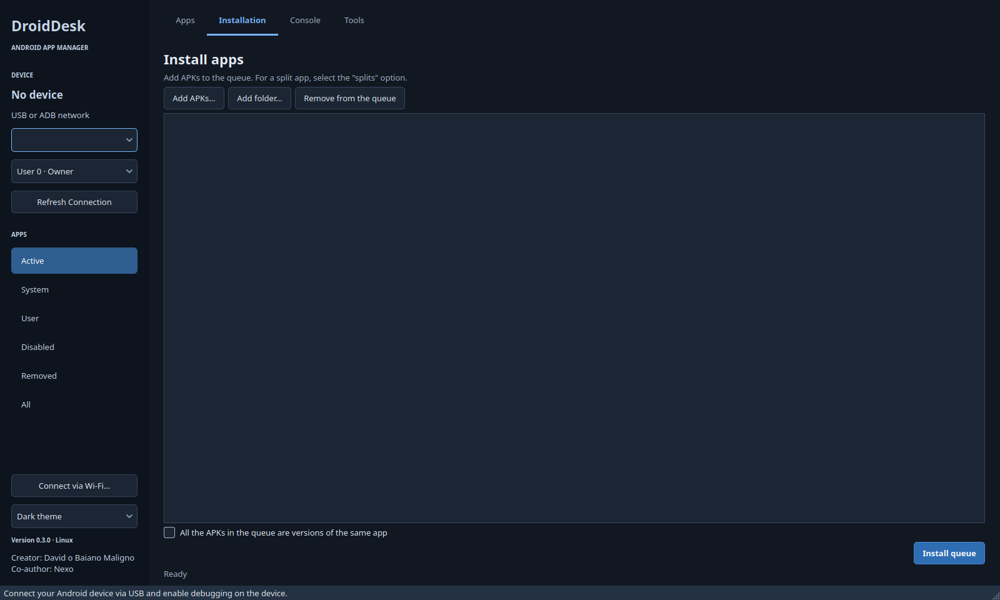
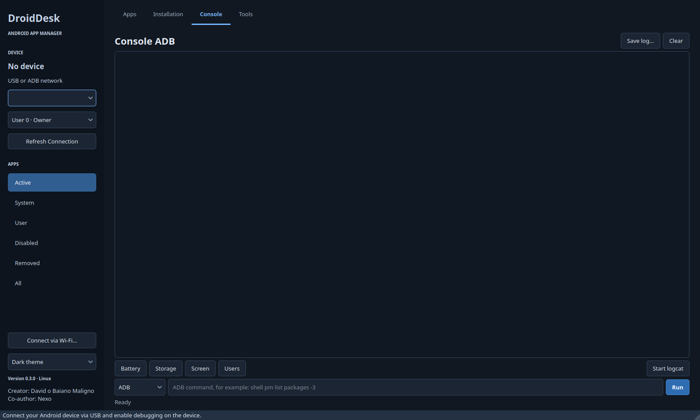
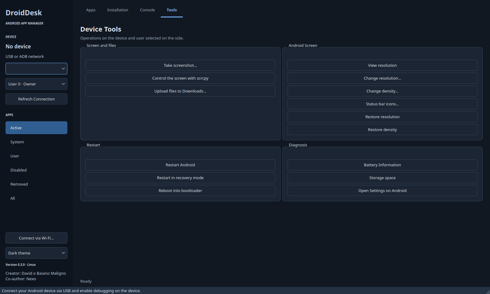

# DroidDesk 0.3.0


**Current version: 0.3.0 · Platform: Linux**










I'm developing DroidDesk to manage Android devices from Linux. It uses Qt and ADB, and is installed by the user.

**Creator: David o Baiano Maligno · Co-author: Nexo**

## Quick Installation

Clone the repository, then run the Linux installer from its directory:

```sh
git clone https://github.com/BaianoMaligno/droiddesk.git
cd droiddesk
sh Install.sh
```

Then just open **DroidDesk** from the menu. The installer detects Debian/Ubuntu, Fedora, Arch, and openSUSE, checks the dependencies, and places the program outside the Downloads folder. Compatibility limitations are listed in [Installation and Compatibility](docs/INSTALLATION.md).

## Documentation

| Document | Content |
|---|---|
| [Installation and Connection](docs/INSTALLATION.md) | Dependencies, opening from the menu, USB, Wi-Fi, and updates |
| [User Guide](docs/USER_GUIDE.md) | Marking, removing, copying, reactivating, presets, and local files |
| [Screenshots](docs/SCREENSHOTS.md) | Themes, confirmation, installation, console, tools, and real tablet |
| [Architecture](docs/ARCHITECTURE.md) | Modules, collector, operations, protection, and development |
| [Functional coverage](FEATURES.md) | Implemented, validated, and pending by resource |
| [Validation 0.2.2](VALIDATION-0.2.2.md) | Actual system removal, restoration, and coverage limits |
| [Validation 0.2.1](VALIDATION-0.2.1.md) | Reproduced regression and actual removal cycle via the interface |
| [Validation 0.2](VALIDATION-0.2.md) | Metadata, permissions, splits, and initial cycle |
| [Upcoming Releases](docs/ROADMAP.md) | Simplified Linux Installation and Decisions for Android |
| [History](CHANGELOG.md) | Changes by version |

## Open

To launch it via the command line, use `sh DroidDesk.sh`. You'll need Python 3.10+, PyQt6 6.4+, and ADB. scrcpy and Fastboot are optional. The device must authorize the connection. For now, there is no dedicated Android app.

## Application Management

- Names, icons, versions, and sizes of the APKs retrieved from the device. The first read fills a local cache; “Update names and icons” refreshes this data.
- Search by name or package; sort and filter by Active, System, User, Disabled, Removed, and All. System and User show active applications; disabled applications appear in their own list.
- The Android device and user are explicitly specified in all operations. Changing the destination clears the previous selection.
- Selection by checkboxes, a button to select visible results, text presets, and a context menu for individual actions.
- Disabling, re-enabling, and removing apps by user; restoring removed system apps; and exporting APKs along with their split files.
- Optional backup before uninstalling. If the export fails, that package is preserved. The backup contains APKs; it does not contain any private app data.
- Batch installation of APKs or installation of the base APK plus splits of the same app, including by dragging files into the window.
- Results and errors per package, with a CSV report. Batch operations continue after a failure and check the status returned by Android.
- Details on Android: opening the app, force stopping, clearing data with confirmation, and viewing, granting, or revoking declared permissions.

Clicking on a row opens the details. **The batch is defined by the checked boxes.** If no boxes are checked, the buttons are disabled. The main button displays the action and the quantity. Updating or filtering the list preserves the selected action and alerts you to any selections that fall outside the filter. When using the context menu, the action applies only to that package.

To remove them, select the apps and click **Uninstall…**. Check the device, Android user, packages, data maintenance, and APK backups. The default folder is `~/Documents/DroidDesk/Backups/<date-time>` and can be changed before confirming. If you cancel, no removal command is sent. The cancellation message appears on the screen and in the console; the results are recorded in the log.

## Appearance

The default theme is dark. You can switch between **Light Theme / Dark Theme** at the bottom of the sidebar, and your selection is saved. Tables, details, menus, scrolling, and confirmation messages follow the app's theme, regardless of your desktop settings.

## Console and Tools

ADB console, interactive shell (`shell`), continuous logcat with start/stop, log saving, Fastboot mode, Wi-Fi connection and pairing, screenshot, sending files to Downloads, integration with scrcpy, resolution, density, status bar icons, and reboot options. Some visual changes depend on the manufacturer.

The console works only on the selected device. Fastboot searches for devices using this protocol. On Samsung devices, Download Mode and Fastboot are two different things.

## Reactivation on Android 16 / Samsung

Android distinguishes between `disabled-user` (`3`), `disabled` (`2`), and `disabled-until-used` (`4`). On the tested tablet, the latter state is associated with `auto_disabler`, Samsung's deep sleep mode.

Packages in state `3` can be reactivated using the ADB command. For states `2` and `4`, Android 16 may refuse the change via the shell. DroidDesk logs “action on Android” and provides **Details on Android**. On the Zul+ screen displayed on the tablet, the system displays the **Activate** button.

The package reader ignores hidden factory version records from `dumpsys package`, which previously overrode the current state of some apps.

## Built-in metadata collector


Metadata and logs are stored in `~/.cache/droiddesk`.

## Validation and Coverage


What has been implemented and what has been validated are listed separately in the documents above. See also [authorship](AUTHORS.md), [signatures](docs/AUTHENTICITY.md), and [installer validation](VALIDATION-0.3.0.md).
