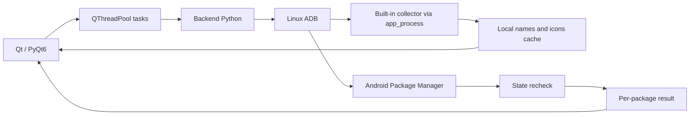

# Architecture and Implementation

In version 0.2.2, `bridge/src/DroidDeskPackages.java` extends the collector with a system-removal operation by user. The backend uses it only for the specific rejection of the standard command that requires root privileges. The helper receives explicit user and package arguments, preserves the data option, checks for absence, and is removed from the target in `finally`. Independent verification by the backend remains mandatory. See [validation 0.2.2](../VALIDATION-0.2.2.md).

## Components



| Archive | Disclaimer |
|---|---|
| `droiddesk.py` | Qt program entry point |
| `qt_app.py` | Window, filters, selection, confirmations, tasks, console, installation, and tools |
| `themes.py` | Complete color palettes and light/dark styles |
| `adb_backend.py` | ADB, models, inventory, operations, and verification |
| `bridge/src/DroidDeskMetadata.java` | Independent metadata collector |
| `bridge/bin/droiddesk-metadata.jar` | DEX distributed for temporary execution on Android |
| `Install.sh` / `install_linux.py` | Distribution-specific dependencies, versioned copy, and stable shortcut |
| `launch.py` | Diagnostics before opening Qt |
| `scripts/build_linux.py` / `scripts/sign_release.py` | Linux packages and distribution signing |
| `tests/` | Regression and opt-in physical tests with a disposable package |
| `scripts/capture_docs.py` | Interface screenshots with live snapshots, without package changes |

## Catalog

The backend queries the installed, known (`-u`), system, and disabled packages, always specifying the user explicitly. It reads `dumpsys package` to distinguish between states 0/1/2/3/4. It ignores hidden blocks from factory versions, preventing an old record from overwriting the actual state.

The `Device`, `Package`, `Snapshot`, and `Outcome` models pass data to the interface. The Qt proxy combines searching and filtering. Row selection is used for inspection; `PackageModel.checked` contains the packages marked for batch actions.

Protection detection adds the current launcher and keyboard to the list of essential packages. This list has a limited scope; it does not replace the manufacturer's policy or a comprehensive debloat.

## Implementation and Results

`Adb.run` uses a subprocess with separate arguments, an explicit target, a timeout, and output reading. It recognizes errors in the exit code and in common Package Manager messages. The batch continues after individual errors. Operations such as disable, re-enable, restore, and remove check the status after the command is executed.

Time-consuming tasks run in `QThreadPool`, with progress, log, completion, and error signals. The interactive shell and logcat use `QProcess`. The interface prevents switching to another window during a task; you should not close the window while the operation is in progress.

In "delete with copy," the export occurs before the delete command. Each copy result applies only to the respective package: a failure preserves that package, while success allows the process to continue. The confirmation captures the device, user, packages, and options before execution.

## Built-in metadata collector

The backend sends the JAR to `/data/local/tmp/droiddesk-metadata-v2.jar`, runs `app_process` as the shell user, and reads one JSON per line. The collector retrieves APK names, PNG icons, versions, UIDs, target SDKs, and sizes. It loads static icon resources: dynamically loading the Samsung calendar icon caused a native crash during development.

The temporary file on Android is removed in `finally`. The cache is per device/profile, with a name derived from a hash of the serial number, and is written to a temporary file. The collector runs locally through ADB and does not install an Android APK or contact an external service. Recompilation instructions: [bridge/README.md](../bridge/README.md).

## Borders and Boundaries

- The program uses the permissions granted to ADB; it does not involve privilege escalation or root access.
- The Android 16 restriction for states 2/4 remains in effect. The interface redirects to the system details screen.
- Binder transaction numbers copied from other versions of Android are not used as a generic attempt to work around bugs.
- The installer covers four families of distributions with system dependencies. It does not include its own APK or an HTTP service for mobile devices.

## Develop and verify

With PyQt6 and ADB available in the environment:

```sh
python3 -B -m unittest discover -s tests -v
```

The local tests cover state parsers, package names, selection, filter switching, cancellation, copy with failure, and themes. They do not require any changes to Android. `tests/test_ui.py` isolates the preferences in a temporary folder and uses Qt offscreen.

Physical tests are separate and require explicit arguments. The manifests for the `org.droiddesk.validation` package are located in `tests/android/`; generate and sign the base and split manifests with the same test key before running the scripts. Binaries and signing keys are not versioned.

```sh
python3 -B tests/validate_removal_ui.py \
  --serial SERIAL \
  --apk /path/to/validation.apk \
  --split /path/to/config.test.apk \
  --output /tmp/droiddesk-validation
```

This test rejects a validation package that already exists in any profile. It interacts with the actual Qt controls and the ADB backend, verifies the copies, and removes its own fixture upon completion. Tests with personal applications do not need to repeat this cycle.

The previous script, `validate_tablet.py`, also covers reactivation, permissions, and cleaning up test data. Its pre-check is based on the selected user; use it in a validated single-profile environment, or extend its protection before using it on a device with multiple profiles.
