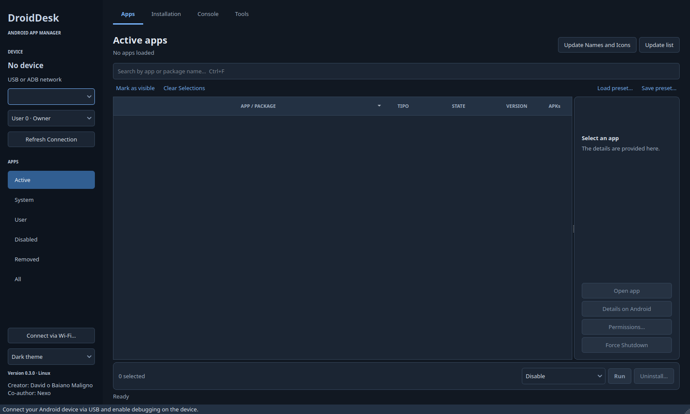
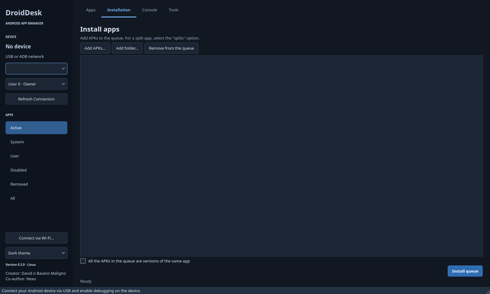
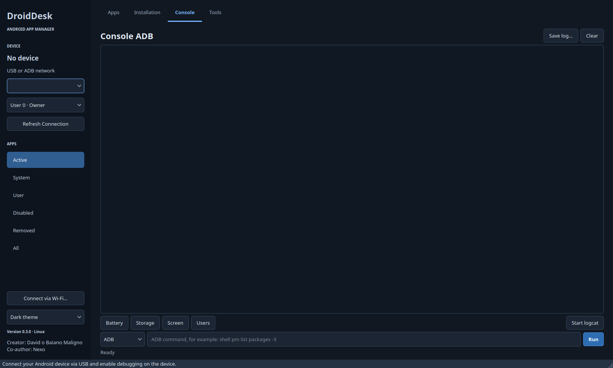
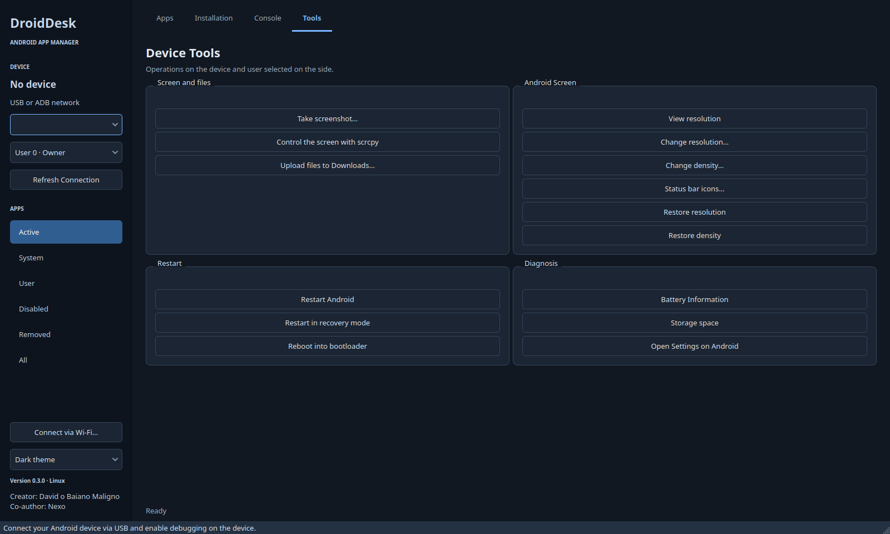

# Screenshots

These images were captured from the DroidDesk 0.3.0 Qt interface on November 4, 2026, with no Android device connected. They show the available screens and controls, not a completed device operation.

## Apps

## Installation

## ADB console

## Device tools

Earlier device screenshots are retained in the private original-history archive. The historical validation reports describe what was observed; this gallery contains only the current English interface.
